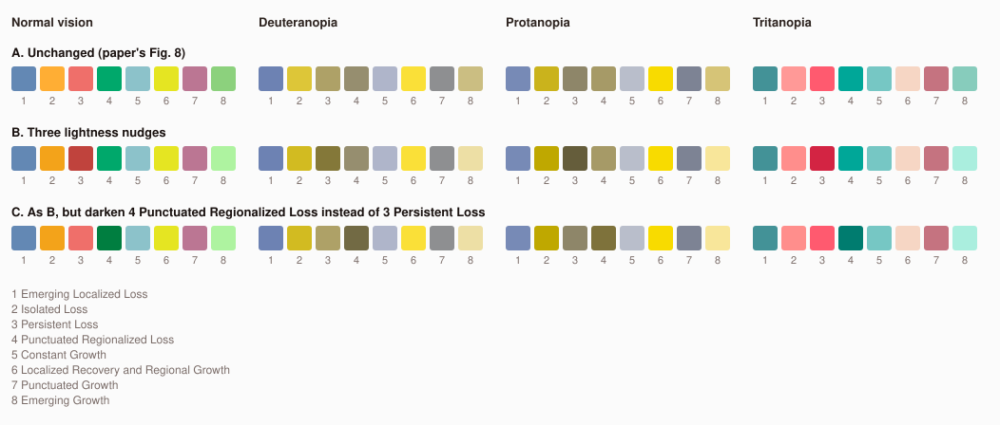

# Pathway colours: options for the low-contrast pairs

For the author's decision (spec 7 and 8.6). **Nothing has changed:** `meta.json` still uses
the paper's Fig. 8 colours. This note lists options to compare against the polished map.

Method: R `colorspace` simulation (Machado 2009, severity 1) and `farver` CIEDE2000, the
same as the 27 Oct change-palette re-check. It does not exactly reproduce the 26 Oct
figures in spec 7, so compare options only within this note. Script:
`pipeline/checks/pathway_colours.R`, which also writes the swatch sheet below.

## What is weak now (option A)

Pairs under ΔE 12 in any simulation, weakest first:

| Simulation | Pair | ΔE |
| --- | --- | --- |
| Tritan | Constant Growth / Emerging Growth | 5.4 |
| Deutan | Isolated Loss / Localized Recovery and Regional Growth | 6.5 |
| Deutan | Persistent Loss / Emerging Growth | 8.1 |
| Protan | Persistent Loss / Punctuated Regionalized Loss | 8.9 |
| Deutan | Persistent Loss / Punctuated Regionalized Loss | 9.1 |
| Protan | Emerging Localized Loss / Punctuated Growth | 9.1 |
| Protan | Isolated Loss / Emerging Growth | 9.7 |

The first, second, fourth and fifth rows are the three pairs in spec 7. This method also
flags Persistent Loss / Emerging Growth (8.1) and Emerging Localized Loss / Punctuated
Growth (9.1), which are not on the spec's list.

## Options

**A. Keep the paper's colours.** The map then matches Fig. 8 exactly. The v1 mitigations
are the pathway filter, legend-hover isolation and pathway names in tooltips and the
profile. Worst pair: ΔE 5.4 (tritan).

**B. Three lightness nudges** (hue and chroma kept; lightness change in HCL):

| Pathway | Now | B | Change |
| --- | --- | --- | --- |
| Isolated Loss | `#ffae34` | `#f3a31a` | slightly darker orange (−4 L) |
| Persistent Loss | `#ef6f6a` | `#c0433d` | darker red (−16 L) |
| Emerging Growth | `#8cd17d` | `#aef3a0` | paler green (+12 L) |

Worst pair rises from 5.4 to 9.1. The three named pairs become 9.1 (deutan, Isolated /
Localized Recovery), 11.7 (deutan, Persistent / Punctuated Regionalized) and 10.8
(tritan, Constant / Emerging Growth). The remaining 9.1 floor is Emerging Localized Loss /
Punctuated Growth (protan), a pair B does not touch.

**C. As B, but darken Punctuated Regionalized Loss** (`#00a86b` → `#007e40`) and keep
Persistent Loss as is. Same worst pair (9.1). Persistent / Punctuated Regionalized rises
to 10.7 (protan) instead of 11.7, and Isolated Loss / Persistent Loss falls to 10.3
(tritan). Choose C to keep the red closer to the paper and change the green instead.

**Limits of lightness alone.** A joint search changed one colour in each of the three pairs
by up to ±36 L (8 choices of colour × 19³ shifts). No such palette gets every pair above
ΔE 9.1, because Emerging Localized Loss / Punctuated Growth caps it. Going higher would
also mean changing hues, or changing a fourth colour (1 or 7), moving further from Fig. 8.

**D. Not colour.** Keep A and add a second channel for the weakest pathways, for example
a hatch pattern on Emerging Growth and Localized Recovery on the map, or a "high
contrast" palette toggle. Either is new interface work, and neither is built.

## What changes if B or C is chosen

- `pipeline/R/outputs.R` `PATHWAYS` colours, so `meta.json` and every view follows. The
  data-dictionary check (`check_dict_palettes`) stops the build when a pathway colour differs
  from `data_dict.docx`, so it would need to list the changed pathways as intended
  differences.
- Spec 7's palette table and colour-vision paragraph, and a Data notes line saying the
  pathway colours differ slightly from Fig. 8 for colour-vision accessibility.
